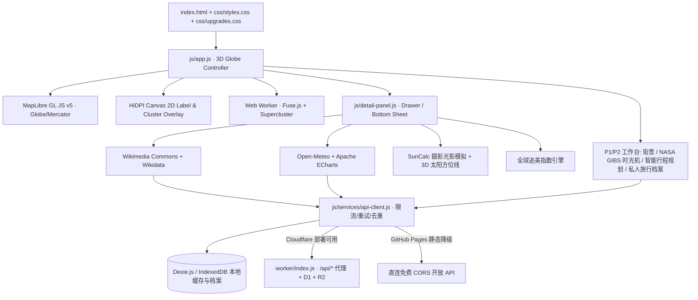

# World Travel Globe — 第一阶段项目审计报告

> 审计日期：2026-11-26 | 仓库分支：`main` | 当前基线提交：`f0cb666`

---

## 一、现有功能清单与数据规模

基于真实源码与 `node scripts/audit-data.js` 全量校验结果：

| 维度 | 实测数值 / 状态 | 说明 |
|---|---|---|
| 大洲分区 | 7（全球总览 + 6 个大洲标签：亚洲、欧洲、大洋洲、北美洲、南美洲、非洲/南极） | 共 42 个主题地理分区（`REGION_ORDER`） |
| 国家及地区 | **137** | 与 `build-dist.js` 强校验一致 |
| 目的地城市 | **722** | 亚洲 245 / 欧洲 133 / 北美 128 / 非洲南极 94 / 南美 74 / 大洋洲 48 |
| 精细摄影机位 | **5,414** | 含 430 个带参考外链机位，全部 5,414 个机位核心字段完整 |
| 月份物候评分 | 722 城 × 12 月完整 | `1★: 224`, `2★: 643`, `3★: 1712`, `4★: 2513`, `5★: 3572` |
| 现有核心能力 | 3D/2D MapLibre v5 地球仪、4 套底图、12 月物候时间轴、多维筛选、图鉴模式、Command Palette、简/繁/英 i18n、昼夜主题与 8 色盘、双档预算、逐日动线、URL `?focus=` 深链、本地收藏 | 已具备完善的前端交互骨架与 `dist/` 分片构建 |

---

## 二、技术架构图

---

## 三、已有问题与风险清单

1. **视觉内容缺失**：目前 722 城与 5,414 机位仅包含文字描述与坐标，缺乏真实实景图片与版权归属展示。
2. **气象与评分静态化**：现有 `months` 与 `weather` 为静态文本和经验评分，缺乏实时气象预报、多年历史气候图表与可解释维度权重。
3. **缺少天文摄影计算**：机位仅提供文字 `bestTime`，缺少按任意日期/时间计算日出日落、黄金/蓝调时刻、太阳方位角与机位朝向联动的能力。
4. **地理数据核验空白**：243 个机位距所属城市中心 >250 km（其中 65 个 >600 km，多为跨省/跨岛大区域合集如“潮汕与丹霞”“阿尔山与乌兰布统”），需生成非破坏性审核队列并接入 Wikidata 交叉校验。
5. **搜索与低缩放密度**：`command-palette.js` 目前为全量线性子串匹配，缺少模糊容错与 Worker 异步索引；低缩放下 722 点全部渲染在球面，缺少空间聚合（Supercluster）。
6. **无本地离线与扩展存储**：仅依赖 `localStorage` 存储收藏/语言/主题，缺少 IndexedDB 持久化、Service Worker PWA 离线支持、个人行程规划及私人足迹管理。
7. **无服务端 API 代理层**：`wrangler.jsonc` 仅配置了静态 `dist/` 托管，缺乏 `/api/*` 代理、服务端密钥隔离与可选 D1/R2 持久化适配器。

---

## 四、第三方服务兼容性矩阵与免费额度/许可证清单

| 资源 / 库 | 用途 | 接入方式 | 免费额度与限制 | 许可证 / 数据授权 | GitHub Pages 静态兼容性 |
|---|---|---|---|---|---|
| **MapLibre GL JS v5** | 3D 球体/2D 地图引擎 | 已内置 `vendor/` | 无限制 | BSD-3-Clause | 完全兼容 |
| **SunCalc** | 日出日落/黄金蓝调/太阳方位/月相 | 内置 `vendor/suncalc.min.js` | 纯本地计算，无限 | BSD-2-Clause | 完全兼容 |
| **Fuse.js** | 全局中英文模糊搜索 | 内置 `vendor/fuse.min.js` | 纯本地计算，无限 | Apache-2.0 | 完全兼容 |
| **Supercluster** | 722 点空间聚合 | 内置 `vendor/supercluster.min.js` | 纯本地计算，无限 | ISC | 完全兼容 |
| **Dexie.js** | IndexedDB 本地存储封装 | 内置 `vendor/dexie.min.js` | 浏览器本地存储 | Apache-2.0 | 完全兼容 |
| **Apache ECharts** | 气候/预算/年度报告图表 | 懒加载 `vendor/echarts.min.js` | 纯本地渲染，无限 | Apache-2.0 | 完全兼容 |
| **Open-Meteo** | 实时天气、7日预报、历史气候 | 直连 CORS / `/api/weather` | 非商用免费，建议 <10,000 req/day，已加 30m/30d 缓存 | CC BY 4.0 | 完全兼容（需标注来源） |
| **RainViewer** | 全球实时雷达与红外云图瓦片 | 公共 JSON + XYZ 瓦片 | 免费公开气象瓦片，无密钥 | 免费非商用公共接口 | 完全兼容 |
| **Wikimedia Commons** | 真实景点照片与作者/协议元数据 | `origin=*` CORS / `/api/commons` | 免费开放，按需加载 + 7 天缓存 + 限流 | CC BY / CC BY-SA / PD 等（逐张标注） | 完全兼容 |
| **Wikidata / Wikipedia** | 地名/坐标/海拔/建筑/遗产校验 | `origin=*` CORS / `/api/wikidata` | 免费开放，按需查询 + 缓存 | CC0 1.0 | 完全兼容 |
| **NASA GIBS WMTS** | 历史卫星真彩/积雪/植被/云图 | 公开 WMTS 瓦片 | 免费无密钥，每日更新 | Public Domain (NASA EOSDIS) | 完全兼容 |
| **OSRM Public Router** | 默认驾车/步行/骑行真实路网路线 | 直连 / `/api/route` | 公共演示节点限流，已加缓存与跨海诚实降级 | BSD-2-Clause / ODbL | 完全兼容 |
| **OpenRouteService** | 可选增强路网（多模式精细路线） | `/api/route`（Worker `ORS_API_KEY`）或用户本地 Key | 免费档 2,000 req/day（需注册免费 Key） | OpenRouteService Terms | 需用户 Key 或 Worker 代理 |
| **MapillaryJS / API** | 街景与 360° 全景 | `/api/streetview`（`MAPILLARY_TOKEN`）或本地 Token | 免费申请 Client Token | MIT (MapillaryJS) / CC BY-SA 4.0 (影像) | 无 Token 时自动降级 Wikimedia 实景+外链 |
| **Cloudflare Workers / D1 / R2** | API 代理、限流、可选云同步与相册 | `worker/index.js` + `wrangler.jsonc` | Workers 10万次/日，D1 5GB，R2 10GB（零费用起步） | Cloudflare Free Tier | GitHub Pages 自动降级为纯本地/直连模式 |

---

## 五、功能开发路线图

- **M1（基建）**：数据审计脚本、OSS 依赖本地化、`StorageDB`（IndexedDB）、`ApiClient`（限流/重试/代理探测）、`AtlasWorker`（Fuse + Supercluster）、PWA 离线外壳。
- **M2（P0 媒体与核验）**：Wikimedia Commons 按需画廊、全屏灯箱、版权标注、Wikidata 校验与冲突审核记录。
- **M3（P0 全球气象）**：Open-Meteo 实时天气 + 7 日预报 + 5 年月度气候 ECharts 图表 + 全球天气雷达/云图图层。
- **M4（P0 摄影模拟器）**：SunCalc 太阳轨迹/方位角/黄金蓝调/月相/拍摄方向与太阳夹角/3D 地球仪射线联动。
- **M5（P0 全球追美指数）**：多维度权重引擎、自定义权重预设、722 城排行榜与数据来源区分标识。
- **M6（P1 街景与时光机）**：Mapillary 街景 + 实景降级、NASA GIBS 历史遥感图层/双日期对比/昼夜晨昏线。
- **M7（P1 智能行程规划）**：多日行程自动生成、拖拽重排、真实路网测距、可编辑预算、JSON/CSV/PDF 导出与 URL 分享。
- **M8（P2 私人档案、高级地球仪与 Worker 后端）**：本地旅行足迹/照片/消费/年报/隐私导入导出、Supercluster 聚合、全屏探索、性能分级与诊断面板、Cloudflare Worker API 代理与 D1/R2 适配器。
- **M9（测试、双端实测与交付）**：`node --test` 自动化测试套件、桌面端与移动端浏览器真实交互验证、文档与清单交付。
