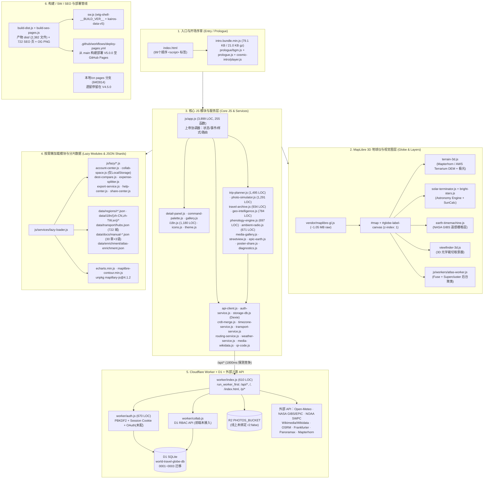

# KAIROS V5.0 架构与代码健康度深度审计报告 (`01_ARCHITECTURE_AUDIT.md`)

> **审计基准**：Commit `cfec5a3`（Tag `v5.0.0`）｜ **对比基线**：`v4.5.0-pre-v5-baseline`（`117` 个文件变更，`+11,309 / -802` 行）  
> **审计方法**：全量静态 AST/复杂度扫描（63 个核心 JS/Worker/脚本文件，`30,036` LOC / `1,332,883` bytes）、构建产物（`dist/` 共 `2,382` 文件）与 Service Worker 路由核查、Git 分支与 CI/CD 流水线比对、多端线上探针实测。  
> **关联证据**：[arch-and-tests-results.json](file:///c:/Users/Liam/Desktop/旅游计划/globe-app/docs/audit-v5/evidence/arch-and-tests-results.json)、[issues.json](file:///c:/Users/Liam/Desktop/旅游计划/globe-app/docs/audit-v5/issues.json)

---

## 1. 架构总览与核心结论

KAIROS V5.0（`world-travel-globe` v5.0.0）采用**无构建框架（Vanilla JS + IIFE 全局挂载）+ 单包静态产物聚合 + Cloudflare Workers 边缘代理与 D1/R2 适配器**的混合架构。该架构使首屏静态部署极为轻量（不依赖 React/Vue 运行时），但经过 V3 → V4 → V5 多轮高频叠加后，已暴露出严重的**全局隐式耦合、上帝文件膨胀、构建脚本与 Service Worker 缓存错位、前后端协议假接通**等结构性债务。

### 1.1 KAIROS V5.0 真实系统架构图

---

## 2. Git 仓库、分支、标签与双线部署拓扑核查

经核查仓库提交历史、标签与工作流配置（[deploy-pages.yml](file:///c:/Users/Liam/Desktop/旅游计划/globe-app/.github/workflows/deploy-pages.yml)）：

| 维度 | 实测状态 | 说明与风险评估 |
| :--- | :--- | :--- |
| **主干最新提交** | `cfec5a3` (`main`, Tag `v5.0.0`) | `release: KAIROS V5.0.0 World Travel Atlas`；前序提交 `a1480e3`、`b593d48` (`v5.0.0-rc1`) |
| **活跃/历史分支** | `main`、`pages`、`v4-dev`、`v5-dev`、`feat/v4`、`remotes/origin/*`、`remotes/cn/*` | 存在多条历史开发分支未清理 |
| **版本标签体系** | `v3.0.0` ~ `v4.5.0`、`v4.5.0-pre-v5-baseline`、`v5.0-batch-1` ~ `v5.0-batch-8`、`v5.0.0-rc1`、`v5.0.0` | 分批里程碑记录清晰 |
| **GitHub Pages 线上真实版本** | **V5.0.0**（`KAIROS. · World Travel Atlas \| 全球智能旅行平台 V5.0`，SW 缓存 `wtg-shell-mwzcd7lq`） | 由 `.github/workflows/deploy-pages.yml` 在每次 `push` 到 `main` 时执行 `node build-dist.js` 并通过 `actions/deploy-pages@v4` 直接上传 `./dist` 部署 |
| **`pages` 分支状态漂移** | `84f2814`（`2026-11-27 20:44:09 +0800`，`chore(pages): sync static dist`） | **停留在 V4.5.0**（`"World Travel Globe · 全球旅行地理图鉴"`，SW 缓存 `wtg-shell-mwyz1yax` / `wtg-data-v4`）。`README.md` 与 `scripts/sync-pages-branch.js` 仍引用的 `pages` 分支已与主站脱节（**`KAIROS-032`**） |
| **CI 质量门禁** | `ci-quality.yml`（push/PR）、`data-governance.yml`（每周一 03:00 UTC） | 虽然门禁跑通 `66/66` 单测与 `15/15` E2E，但测试本身存在大量浅层与假断言（详见 `09_TEST_COVERAGE_AUDIT.md`） |

**生产与静态站运行模式差异**：
- **Production Workers**（`https://world-travel-globe.globe-app.workers.dev/`）：通过 [wrangler.jsonc](file:///c:/Users/Liam/Desktop/旅游计划/globe-app/wrangler.jsonc) 绑定 `ASSETS` 与 D1 `world-travel-globe-db`，`run_worker_first` 拦截 `/api/*`、`/`、`/index.html`、`/p/*`。实测 `/api/health` 返回 `d1: true, auth: true, collab: true`，但 `r2: false, oauthGoogle: false, emailDelivery: false, poisEnhanced: false`。
- **GitHub Pages**（`https://haoyuliu1007.github.io/world-travel-globe/`）：纯静态托管 `./dist`，无 `/api/*` 后端，运行在 `static-direct` 模式。

---

## 3. 目录结构、脚本加载依赖与构建产物分析

### 3.1 源码规模与复杂度基线

全仓核心代码（`js/`、`worker/`、`scripts/`、`assets/prologue/`）共审计 **63 个 JS/脚本文件**（`30,036` LOC，约 `1.33 MB`）及 **5 个核心 CSS 文件**：
- **CSS 规模**：`css/styles.css`（`3,208` LOC / `67.6 KB`，`!important` 23 处）、`css/upgrades.css`（`2,482` LOC / `59.6 KB`，`!important` 14 处）、`assets/prologue/prologue.css`（`1,176` LOC / `31.3 KB`）、`assets/cosmic-intro/player.css`（`126` LOC）、`assets/brand/brand-tokens.css`（`99` LOC）。
- **脚本加载顺序（[index.html:661-763](file:///c:/Users/Liam/Desktop/旅游计划/globe-app/index.html#L661-L763)）**：共 **99 个顺序 `<script>` 标签**：
  1. **Vendor 同步库（8 个）**：`maplibre-gl.js` → `suncalc.min.js` → `fuse.min.js` → `supercluster.min.js` → `dexie.min.js` → `astronomy.browser.min.js` → `minisearch.min.js` → `tz-lookup.min.js`。
  2. **地理数据分片（56 个）**：`data/registry.js` 必须居首，其后 55 个区域 JS 文件逐一调用 `window.TRAVEL_ATLAS.registerDestinations(...)` 汇入 `722` 城 / `5,414` 机位 / `137` 国家地区。
  3. **应用逻辑与服务（35 个）**：`icons.js` → `i18n.js` → `theme.js` → `lazy-loader.js` → 10 个 `js/services/*.js` → 19 个 `js/modules/*.js` → `detail-panel.js` → `command-palette.js` → `gallery.js` → `app.js`。

### 3.2 `build-dist.js` 构建产物与首屏负载（关联 **`KAIROS-023`**）

[build-dist.js](file:///c:/Users/Liam/Desktop/旅游计划/globe-app/build-dist.js) 将 `index.html` 的离散引用重写为 5 个同步 Bundle 与若干按需分片，最终生成 **`2,382` 个产物文件**（含 `722` 个 SEO 静态页面 `dist/p/*/index.html`、`722+1` 张 `1200×630` OG 卡片 `dist/og/*.png`、`sitemap.xml`、20 个大洲/区域分片 `data/regions/r*.json` 及 `r*.js`）。

| 产物文件 | 原始体积 | Gzip 体积 | 加载方式 | 性能与结构评价 |
| :--- | :--- | :--- | :--- | :--- |
| `js/app.bundle.min.js` | `899.0 KB` | `239.4 KB` | 首屏同步阻塞 | 将 35 个应用脚本直接 `\n;\n` 拼接（**未做 AST 压缩/Tree-shaking**），包含极少访问的重型模块 |
| `data/atlas-index.min.js` | `1,265.6 KB` | `451.2 KB` | 首屏同步阻塞 | 722 城轻量索引仍高达 1.27 MB 未压缩 JS，主线程同步解析耗时长 |
| `vendor/libs.bundle.min.js` | `351.2 KB` | `129.3 KB` | 首屏同步阻塞 | 同时打包 `suncalc` + `astronomy.browser`（116.7 KB）、`fuse` + `minisearch` 两套重复引擎 |
| `vendor/maplibre-gl.js` | `~1.05 MB` | — | 首屏同步阻塞 | 核心 WebGL 引擎，无 `defer` |
| `css/app.bundle.min.css` | `225.2 KB` | `35.7 KB` | 首屏阻塞样式 | 合并 5 份 CSS，含未使用的重型弹窗样式 |
| `assets/prologue/intro.bundle.min.js` | `79.1 KB` | `21.0 KB` | 首屏同步阻塞 | 即使 `?instant=1` 或跳过开场也会同步加载并预加载 MP3 |

在隔离 CDP 实测中（**`KAIROS-023`**），桌面冷启动传输 `1,912 KB`（解码 `5,693 KB`，`loadMs 7,084ms`，`TBT 403ms`）；开启开场动画达 `2,619 KB`；低端 6x CPU 下 `TBT` 高达 `3,262ms`；Slow 3G 下 `DCL 24,552ms`、`loadMs 35,653ms`。

---

## 4. Service Worker / PWA 缓存架构缺陷（关联 **`KAIROS-028`**）

[sw.js](file:///c:/Users/Liam/Desktop/旅游计划/globe-app/sw.js) 与 [build-dist.js:280-295](file:///c:/Users/Liam/Desktop/旅游计划/globe-app/build-dist.js#L280-L295) 共同构成离线优先层，但在缓存分区与兜底响应上存在 3 处结构性 bug：

1. **Vendor 缓存键冲突与永久残留（`sw.js:60` vs `build-dist.js:286-287`）**：
   `build-dist.js` 将 `./vendor/libs.bundle.min.js?v=${buildVer}` 与 `./vendor/maplibre-gl.js` 写入版本化预缓存数组 `CORE_ASSETS`（存入 `CACHE_NAME = wtg-shell-<ver>`）；但 `sw.js:60` 的 `fetch` 拦截器**优先**匹配 `url.pathname.includes('/vendor/')`，并将其写入**无版本号的 `DATA_CACHE = 'kairos-data-v5'`**。结果：
   - 预缓存的 `CACHE_NAME` 在运行时被绕过，同一资源在两个 CacheStorage 中双份存储；
   - 版本升级 `activate` 时只清理非 `CACHE_NAME` 且非 `DATA_CACHE` 的键，导致旧版 `libs.bundle.min.js?v=old` 永驻 `kairos-data-v5` 无法淘汰。
2. **离线未命中返回 `null` 触发 SW `TypeError`（`sw.js:121`）**：
   兜底的 `staleWhileRevalidate` 分支中 `netPromise` 在 `.catch(() => null)` 后返回 `null`，`return hit || (await netPromise)` 在离线未命中时将 `null` 传给 `event.respondWith()`，违反 FetchEvent 规范（必须返回 `Response`），引发浏览器控制台报错。
3. **关键离线资产遗漏**：`manifest.webmanifest`、`assets/skyboxes/*` 以及物候/搜索核心依赖 `data/enrichment/atlas-enrichment.json` 均未被加入 `CORE_ASSETS` 或 `DATA_CACHE` 匹配规则，纯离线状态下物候/天空盒能力退化。

---

## 5. 十项架构坏味道深度审计

### 5.1 重复实现 (Duplicate Implementations)

1. **两套昼夜晨昏线计算（`KAIROS-027`）**：[earth-timemachine.js:114-138](file:///c:/Users/Liam/Desktop/旅游计划/globe-app/js/modules/earth-timemachine.js#L114-L138) 仍保留基于 `tan(declRad)` 近似与 `±85°` 截断的 `buildNightTerminatorPolygon()`，而 V4.5 已在 `js/modules/solar-terminator.js` 重写了基于球面亚太阳点大圆与国际日界线裁剪的精确 `SolarTerminator`。
2. **双搜索库与双天文库共存（`KAIROS-016`、`KAIROS-034`）**：`vendor/fuse.min.js`（26.4 KB）与 `vendor/minisearch.min.js`（19.3 KB）同时打入 `libs.bundle.min.js`，且 `fuse.min.js` 额外独立复制给 `atlas-worker.js`；`vendor/suncalc.min.js`（17.4 KB）与 `vendor/astronomy.browser.min.js`（116.7 KB）同时打入首屏 Bundle，导致 `PhotoSimulator` 混用 `SunCalc`（缺乏 `utcOffset` 引发 Reykjavik 夏至 24 小时日落跳变）与 `Astronomy Engine`。
3. **双音频实例预加载冲突（`KAIROS-034`）**：`assets/prologue/bgm.js`（297 LOC）在顶层即实例化 `new Audio("assets/prologue/the-blue-horizon.mp3?v=1")` 并设 `preload="auto"`，而 `js/modules/ambient-radio.js`（671 LOC）将同一首 MP3 列为 Track 00 并通过手动停止 `CosmicBGM` 实现互斥。
4. **品牌源图字节级重复（`KAIROS-034`）**：`assets/brand/source/` 存放 18 个 PNG（约 `20 MB`），其中 9 个 `ChatGPT 图像 2026年11月28日 *.png` 与 9 个 `kairos-*.png` 的 SHA-256 哈希完全一致。
5. **分享双入口与命名混淆（`KAIROS-021`）**：`js/modules/poster-share.js`（515 LOC）与 `js/lazy/share-center.js`（234 LOC）职责交叠且互相跳转；`js/gallery.js`（722 城目录网格）与 `js/modules/media-gallery.js`（单城 Commons 实景图库）命名相近易引发维护误判。

### 5.2 废弃 / 未使用模块与资产 (Deprecated / Unused Modules)

- **`pages` 分支与 `scripts/sync-pages-branch.js`（`KAIROS-032`）**：GitHub Actions 已切换为从 `main` 直出部署，`pages` 分支（`84f2814`）成为停留在 V4.5.0 的陈旧孤儿分支。
- **`assets/brand/social/preview-primary.png`（`KAIROS-034`）**：`build-dist.js` 将其复制到 `dist/`，但全仓 HTML/JS/文档无任何引用。
- **`window.AppSkybox`（`js/app.js:707`）**：仅暴露全局对象，外部零调用方。

### 5.3 死代码 / 未调用代码 (Dead / Uncalled Code)

- **半接通的协同通道（`KAIROS-003`）**：[collab-space.js:35-38](file:///c:/Users/Liam/Desktop/旅游计划/globe-app/js/lazy/collab-space.js#L35-L38) 向 `BroadcastChannel('kairos_collab')` 发送 `space_update`，但**全仓 0 个文件监听该频道的 `onmessage` 或 `addEventListener`**；同时后端 `worker/collab.js` 完整实现了 10 余个 `/api/collab/*` 端点，前端 `CollabSpace` 却**从不发起任何 HTTP 请求**，只用 `useCloud` 控制显示 `"D1 Cloud RBAC"` 徽标。
- **解析后即丢弃的 URL 参数（`KAIROS-021`）**：[js/app.js:2396-2416](file:///c:/Users/Liam/Desktop/旅游计划/globe-app/js/app.js#L2396-L2416) 的 `readInitialUrlState()` 费力解析 `camBearing`、`dateStr`、`layers`，但全文件后续逻辑从未消费这三个字段。
- **无事件绑定与无效传参（`KAIROS-021`）**：[share-center.js:116, 200](file:///c:/Users/Liam/Desktop/旅游计划/globe-app/js/lazy/share-center.js#L116) 中 `#sc-type-sel` 下拉框没有 `change` 监听器；传给 `PosterShare.renderPosterCanvas` 的 `bullets` 字段被 `poster-share.js` 完全忽略。
- **未读取的智能检索意图标志与物候特征**：`geo-intelligence.js` 解析出的 `preferWarm`、`preferCool`、`preferTransit`、`photoScene`、`pace` 5 个标志位在评分函数中从未被读取（**`KAIROS-025`**）；`validate-phenology.js` 定义了 `winterMeanC` 字段但模型未读取（**`KAIROS-015`**）。
- **死 DOM 节点**：`index.html` 中的 `#loader-text`（L70）、`#layer-meta-inspector`（L431）、`#layer-meta-legend`（L437）在 JS 和 CSS 中均无引用或仅停留在正则占位测试中（**`KAIROS-034`**）。

### 5.4 循环与隐式加载顺序依赖 (Circular / Implicit Load-Order Dependencies)

系统未采用 ES Modules (`import`/`export`)，依赖 `index.html` 中 **99 个 `<script>` 的物理书写顺序**：
- 55 个区域数据文件隐式依赖 `data/registry.js` 先行初始化 `window.TRAVEL_ATLAS`；
- `js/modules/*` 隐式依赖 `js/services/*` 与 `AppI18n` / `AppIcons`；
- `js/app.js` 末尾执行时假设此前 34 个脚本全部挂载成功，而 `trip-planner.js`、`detail-panel.js` 等内部又反向调用 `window.getGlobeMap()`、`window.switchAppLanguage()` 等由 `app.js` 或晚加载模块定义的全局函数，构成事实上的**运行期双向隐式循环依赖**。
- `LazyLoader` 动态加载 `js/lazy/*` 时隐式依赖宿主已挂好 `AppI18n`、`AuthService`、`QRCodeService`、`PosterShare`；静态 SEO 页或局部单测环境极易因缺少前置全局对象而降级静默失败。

### 5.5 过度耦合 (Over-Coupling)

- **`js/app.js` 中心化强耦合**：单个文件直接绑定 25+ 全局命名空间和 100+ 硬编码 DOM ID（如 `#detail-drawer`、`#topbar`、`#planner-view`、`#timemachine-dock` 等），视图切换、地图样式构建、事件委托与模态框管理混为一谈。
- **跨用户本地存储无隔离耦合（`KAIROS-012`）**：`StorageDB`（IndexedDB `WorldTravelGlobeDB`）与 `localStorage`（`wtg_collab_spaces_v1`、`wtg_favorites_v1`）未按 `userId` 分区，导致用户 A 退出后用户 B 登录可读取 A 的 `cloudSyncPassphrase` 并将 A 的本地足迹/行程误迁移至 B 的云端账号。
- **CSS Token 断链耦合（`KAIROS-006`）**：`css/upgrades.css:2455` `.modal-card` 引用了 `styles.css` 中**从未定义**的 `--bg-panel`，导致明亮模式下所有 V5 懒加载弹窗退化为深海军蓝底配 `#18181B` 黑色文字（对比度仅 `~1.1:1`）。

### 5.6 上帝文件与高复杂度函数 (God Files & Complex Functions)

| 文件路径 | LOC | 字节数 | 内部函数数 | 最复杂函数 / 代码块 | 圈/嵌套深度 | 主要架构问题 |
| :--- | :---: | :---: | :---: | :--- | :---: | :--- |
| [js/app.js](file:///c:/Users/Liam/Desktop/旅游计划/globe-app/js/app.js) | **3,899** | 145,823 | 255 | `bindEvents` (L2419-3153, **735行**) `starfield` (L260-705, 446行) `buildStyle` (L825-1078, 254行) | 最大嵌套 8 花括号深度 9 | 超级上帝协调器，包揽 WebGL 星空粒子、底图样式、URL 状态、全局快捷键、UI 交互 |
| [js/modules/trip-planner.js](file:///c:/Users/Liam/Desktop/旅游计划/globe-app/js/modules/trip-planner.js) | **1,495** | 82,484 | 76 | `tripToCsv`/主体渲染块 (L532-1186, **655行**) | 最大嵌套 6 花括号深度 7 | 将路径优化、跨城生成、FX 预算、清单、拖拽 DOM、CSV/URL 序列化混写于一处 |
| [assets/prologue/prologue.js](file:///c:/Users/Liam/Desktop/旅游计划/globe-app/assets/prologue/prologue.js) | **1,324** | 58,779 | 62 | `buildDom` (L222-548, 327行) | 最大嵌套 4 | 大量内联 DOM 构造与多幕动画状态机耦合 |
| [js/modules/photo-simulator.js](file:///c:/Users/Liam/Desktop/旅游计划/globe-app/js/modules/photo-simulator.js) | **1,291** | 70,229 | 60 | `mount` (L741-1264, **524行**) | 最大嵌套 7 花括号深度 8 | 混杂天文数学、POI 评分、DEM 回调、天气拉取与巨型 HTML 模板拼接 |
| [js/i18n.js](file:///c:/Users/Liam/Desktop/旅游计划/globe-app/js/i18n.js) | **1,180** | 58,654 | 24 | 巨型字典 + `hydrateStaticDom` | 花括号深度 5 | 静态翻译大字典硬编码在主运行包内，未拆分 JSON |
| [js/modules/travel-archive.js](file:///c:/Users/Liam/Desktop/旅游计划/globe-app/js/modules/travel-archive.js) | **934** | 47,265 | 65 | `renderWorkspace` (L302-841, **540行**) | 最大嵌套 9 花括号深度 10 | 足迹统计、EXIF 剥离、云同步面板、游记编辑器高度缠绕 |
| [worker/index.js](file:///c:/Users/Liam/Desktop/旅游计划/globe-app/worker/index.js) | **610** | 27,386 | 6 | `handleApi` (L65-570, **506行**) | 最大嵌套 6 | 15+ 路由全部平铺在顺序 `if (p === ...)` 中，缺少统一中间件/校验器 |
| [worker/auth.js](file:///c:/Users/Liam/Desktop/旅游计划/globe-app/worker/auth.js) | **670** | 29,419 | 16 | `handleAuthRequest` (L215-667, **453行**) | 最大嵌套 5 | 认证/注册/OAuth/密码重置/账号注销全堆叠在单一巨型分发函数 |

> 另：`js/detail-panel.js`（809 LOC）、`js/modules/terrain-3d.js`（809 LOC）、`js/modules/geo-intelligence.js`（784 LOC）、`js/modules/phenology-engine.js`（697 LOC）、`js/modules/ambient-radio.js`（671 LOC）、`js/modules/streetview.js`（663 LOC）、`js/services/storage-db.js`（605 LOC）亦均超过 600 行，其中多达 10+ 个模块内含超过 200 行的 HTML 字符串拼装函数。

### 5.7 隐式全局变量 (`window.*`)

全站 35+ 业务脚本和 7 个懒加载模块全部通过 `(function (global) { global.ModuleName = ...; })(window)` 直接向 `window` 暴露 40 余个顶层符号（如 `TRAVEL_ATLAS`、`AppI18n`、`AppIcons`、`AppSkybox`、`ApiClient`、`AuthService`、`StorageDB`、`CRDT`、`TripPlanner`、`CollabSpace` 等），加之 `window.getGlobeMap`、`window.switchAppLanguage` 等全局方法。其后果是：
- 无法进行静态死代码消除（Tree-shaking）或作用域隔离；
- `index.html` 任意调整脚本顺序或懒加载失败时即出现间歇性 `undefined`；
- 多处模块通过直接读写全局对象完成跨层操作，破坏了模块边界。

### 5.8 异步竞态条件与缺少 `AbortController`（关联 **`KAIROS-031`**、**`KAIROS-026`**、**`KAIROS-009`**）

1. **`AbortController` 全线缺席（`KAIROS-031`）**：虽然 [api-client.js:161-170](file:///c:/Users/Liam/Desktop/旅游计划/globe-app/js/services/api-client.js#L161-L170) 的 `createCombinedSignal` 显式支持外部传入 `AbortSignal`，但 **`media-wikidata.js`、`weather-service.js`、`routing-service.js`、`auth-service.js`、`streetview.js` 以及全部 UI 面板无一传入 `AbortController`**。快速切换城市或抽屉标签页时，慢响应的旧请求可能后发先至覆盖新城市界面。
2. **EPIC 日期快速切换竞态（`js/modules/epic-earth.js:225-230`）**：连续修改 `#epic-date-input` 触发多次未取消的 `fetchEpicFrames()`，无序号校验或 `abort()`，旧日期帧列表可覆写 `framesCache` 与弹窗。
3. **TimeMachine 重入锁缺失（`js/modules/earth-timemachine.js:370-377`）**：`toggleDock()` 异步 `await syncLatestGibsDate()` 且无互斥锁，快速双击会导致 `isOpen` 状态与 `applyLayersToMap()` 图层挂载状态错位。
4. **地图样式加载期状态丢失（`KAIROS-026`）**：`terrain-3d.js` 在 `!map.isStyleLoaded()` 时直接 `return`，未排队挂起 `styledata`/`idle` 回调，底图切换期间点击 3D 建筑/夜光/极光开关被静默丢弃。
5. **后端并发覆盖写竞态（`KAIROS-009`）**：`worker/collab.js:124-140` 的 `PUT /api/collab/trips/:id` 忽略客户端版本直接 `UPDATE trips ... WHERE id = ?`，多人并发编辑发生静默后写覆盖（Lost Update）。

### 5.9 无效或静默回退 (Invalid / Silent Fallbacks)

- **162 处静默 `catch` 块（`KAIROS-031`）**：全仓共统计到 **162 个**空 catch 或直接返回空值/忽略异常的 catch 块，排名前列的文件：
  - `js/app.js`（18 处，如 L59, L69, L287, L670 `catch (e) { // ignore }`）
  - `worker/auth.js`（11 处，如 L103, L112 `return false;` 及多处 `.catch(() => null)`）
  - `js/modules/ambient-radio.js`（10 处 `catch {}`）
  - `js/modules/trip-planner.js`（9 处 `catch (e) {}` / `.catch(() => {})`）
  - `assets/prologue/bgm.js`（9 处）、`worker/index.js`（8 处）、`js/modules/terrain-3d.js`（7 处）、`js/services/media-wikidata.js`（7 处）、`worker/collab.js`（6 处）、`js/modules/epic-earth.js`（5 处）。
- **`api-client.js` 1800ms 探针永久假阴性缓存（`KAIROS-022`）**：[api-client.js:118-159](file:///c:/Users/Liam/Desktop/旅游计划/globe-app/js/services/api-client.js#L118-L159) 的 `detectWorkerCapabilities()` 仅设 `1800ms` 超时，一旦冷启动 Worker 或高 RTT 超过 1.8s，L153 便**永久缓存** `workerCapabilities = fallback`（`available: false`）直至刷新页面！生产站实拍截图 [prod-16-account-modal.png](file:///c:/Users/Liam/Desktop/旅游计划/globe-app/docs/audit-v5/screenshots/prod-16-account-modal.png) 即证实了 Workers 线上环境竟弹出 `"当前访问环境为纯静态浏览模式"`。
- **把所有路由异常一律伪装成 `"跨海"`（`KAIROS-020`）**：`routing-service.js:154-162` 在任意 OSRM 超时或 HTTP 异常时一律返回 `crossSea: true`，导致北京同城内两景点寻路失败也被标记为跨海。
- **静默截断超长 QR 字节（`KAIROS-019`）**：`qr-code.js:85` 对超过 V10 容量的分享链接执行 `bytes.slice(0, dataCap - 3)`，生成损坏 URL 的二维码且不向用户报错。

### 5.10 文档与代码不一致 (Doc-vs-Code Discrepancies)

| 文档 / UI 宣称 | 源码与线上实际行为 | 对应问题 ID |
| :--- | :--- | :---: |
| **`ExportService` 8 种导出格式**（`V5_ACCEPTANCE_REPORT.md` / Tracker） | `ExportService` 仅实现 7 种（JSON / CSV / ICS / GPX / KML / GeoJSON / Print HTML），**缺失 Markdown (`.md`)**，第 8 种实为 `PosterShare` PNG | **`KAIROS-021`** |
| **`CollabSpace` 连接 D1 服务端 RBAC + BroadcastChannel 实时同步** | `collab-space.js` 从未调用 `/api/collab/*`，所有操作写 `localStorage`；`BroadcastChannel('kairos_collab')` 全仓 0 监听者 | **`KAIROS-003`** |
| **`ShareCenter` 精确深度链接恢复机位/方位角/日期/图层 + 12 类分享 + 本地二维码** | `app.js` 忽略 `cam`/`date`/`layers`；`#sc-type-sel` 无 `change` 事件；`renderSvg(url, 136)` 传参类型错导致退回 180px；V7–V10 二维码缺定位格与版本信息导致完全不可扫；`bullets` 参数被 `PosterShare` 忽略 | **`KAIROS-007`、`KAIROS-019`、`KAIROS-021`** |
| **`EarthTimeMachine` 分屏对比卷帘 & 全三语支持** | 仅通过 `raster-opacity`（`1 - mix` vs `mix`）叠加渐变，并非空间分屏卷帘；整个 `#timemachine-dock` 硬编码简体中文 | **`KAIROS-027`** |
| **`ExpenseSplitter` 最优少转账结算 (`Minimum-Transfer`)** | 实际为贪心撮合而非最小转账数（5 人反例需 3 笔，贪心输出 4 笔），且浮点精度存在 1 分钱漂移 | **`KAIROS-018`** |
| **Git `pages` 分支镜像**（`README.md` / `sync-pages-branch.js`） | `pages` 分支（`84f2814`）停留在 V4.5.0；实际生产 GH Pages 由 `deploy-pages.yml` 从 `main` 直接构建 V5.0.0 | **`KAIROS-032`** |
| **E2E Scenario 15 跨标签协同收敛测试**（`e2e/globe.spec.mjs:511`） | 打开 `ctxB` 后未执行任何协同编辑或频道通信即关闭，仅检查 `#topbar` 按钮 `aria-label` | **`KAIROS-032`** |
| **`BRAND_GUIDELINES.md:31`** 称 `assets/brand/source/` 含 9 张 PNG | 实际包含 18 张 PNG（约 20 MB），其中 9 张为字节级重复副本 | **`KAIROS-034`** |

---

## 6. 长期可扩展性评估与务实演进路线（拒绝盲目 SPA 重写）

KAIROS 的核心资产是 **MapLibre GL 3D 地理渲染、722 城/5,414 机位结构化数据集与天文/物候/路由计算引擎**。将本项目推倒重写为 React/Next.js SPA 不仅无法解决上述任何业务算法、安全或缓存问题，反而会引入额外的虚拟 DOM 开销与迁移风险。**建议保留纯原生轻量化技术底座，在 3 个阶段内完成渐进式架构治理**：

### 阶段 1：工程与边界止血（1 周内，低风险）
1. **引入原生 ES Modules + esbuild 打包（替代 `\n;\n` 字符串拼接）**：保留 Vanilla JS 零框架优势，用 `esbuild` 替代 `build-dist.js` 手工拼接，消除 `window.*` 隐式全局依赖与 99 `<script>` 加载顺序风险，并自动产出压缩后体积更小的 Bundle。
2. **数据与首屏解耦**：将 `data/atlas-index.min.js`（1.27 MB 同步解析）与 `js/i18n.js` 字典改为 `fetch` JSON + Web Worker (`atlas-worker.js`) 异步流式加载，`intro.bundle.min.js` 与 `bgm.js` 仅在非 `?instant=1` 时按需加载（解决 **`KAIROS-023`**）。
3. **修复 SW 缓存分层与能力探测**：调整 `sw.js` 匹配优先级使 `CACHE_NAME` 优先接管版本化核心包，兜底返回 `503 Response`（**`KAIROS-028`**）；将 `detectWorkerCapabilities()` 超时提至 `5000ms` 且失败不永久缓存（**`KAIROS-022`**）。

### 阶段 2：上帝文件拆解与协议对齐（2–3 周）
1. **拆分 `js/app.js`（3,899 LOC）与 `trip-planner.js`（1,495 LOC）**：按职责切分为 `globe-renderer.js`、`starfield-layer.js`、`url-state-router.js`、`modal-manager.js`（统一 `Escape` 与无障碍焦点管理，解决 **`KAIROS-030`**）及 `planner-state.js` / `planner-ui.js`。
2. **统一请求生命周期**：为所有域服务（`weather-service`、`media-wikidata`、`epic-earth`）建立基于 `AbortController` 的取消令牌机制，废除静默 `catch {}`，统一接入 `Diagnostics` 错误通道（**`KAIROS-031`**）。
3. **Worker 后端工程化**：在保持 Cloudflare Workers 无服务器架构前提下，引入轻量 `Hono` + `Zod` 替代 `worker/index.js` 与 `worker/auth.js` 中 500 行的手写 `if/else` 链，补齐统一 CSRF 中间件、乐观锁与速率限制（**`KAIROS-001`~`014`**）。

### 阶段 3：用成熟开源微库替换高风险手写算法（2 周）
- **QR 编码**：用 `nayuki/QR-Code-generator`（MIT）替换手写 `qr-code.js`（**`KAIROS-007`、`KAIROS-019`**）。
- **多端协同与 CRDT**：采用 `Yjs`（MIT）或严格的全局 LWW-Element-Set + 语义序列替代故障率 73.3% 的手写 `mergeTripDocuments`，并真正接通 `CollabSpace` ↔ `/api/collab/*` ↔ `BroadcastChannel`（**`KAIROS-003`、`KAIROS-004`**）。
- **单一搜索与天文引擎**：下线 `SunCalc` 与 `Fuse.js`（由已捆绑的 `Astronomy Engine` 与 `MiniSearch` 统一承担），配合 `OurAirports` 完整 CSV 与 `Natural Earth` 陆地多边形修复跨海高铁与海外机场错配（**`KAIROS-005`、`KAIROS-016`、`KAIROS-017`**）。
- **仓库资产与分支清理**：删除 `assets/brand/source/` 10 MB 重复图片，归档或同步废弃 `pages` 分支，使文档、分支与部署现实完全一致（**`KAIROS-032`、`KAIROS-034`**）。
